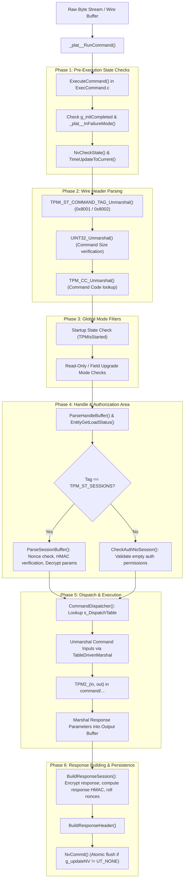

# TPM 2.0 Core Reference Guide (`vendor/TPM`)

> **Comprehensive Technical Guide & Execution Architecture for the TCG TPM 2.0 Reference Implementation**
>
> This document details the internal architecture, function execution pipeline, subsystem mechanics, target test functions, edge cases, and code coverage hurdles within the reference implementation located under `vendor/TPM`.

---

## 1. Directory Structure & Module Layout

The reference implementation under `vendor/TPM/TPMCmd` is split into distinct layers:

```
vendor/TPM/TPMCmd/
├── Platform/              # Platform abstraction layer (NVRAM, hardware timer, entropy, localities)
│   ├── src/RunCommand.c   # Platform entry point wrapping ExecuteCommand with setjmp/longjmp error handling
│   └── src/NVMem.c        # Simulated non-volatile memory backing store
├── Simulator/             # Socket server wrapper (unused in in-process fuzzing)
└── tpm/
    └── src/
        ├── main/          # Core execution engine, command dispatch, and session processing
        │   ├── ExecCommand.c        # Main entry point (ExecuteCommand)
        │   └── CommandDispatcher.c  # Table-driven dispatch and parameter unmarshaling
        ├── command/       # 24 modular directories implementing TPM 2.0 commands
        │   ├── Asymmetric/          # RSA_Encrypt, RSA_Decrypt, ECDH_KeyGen, ECDH_ZGen
        │   ├── Hierarchy/           # CreatePrimary, Clear, HierarchyControl, SetPrimaryPolicy
        │   ├── Object/              # Create, Load, MakeCredential, ReadPublic, Unseal
        │   ├── PCR/                 # PCR_Allocate, PCR_Event, PCR_Read, PCR_SetAuthPolicy
        │   ├── NVStorage/           # NV_DefineSpace, NV_Read, NV_Write, NV_UndefineSpace
        │   ├── Session/             # StartAuthSession, PolicyRestart
        │   ├── Random/              # GetRandom, StirRandom
        │   └── EA/                  # Enhanced Authorization (PolicyPCR, PolicySecret, etc.)
        ├── subsystem/     # Internal state managers
        │   ├── Object.c             # Object table slots (transient & persistent RAM eviction)
        │   ├── Session.c            # HMAC & Policy authorization session context table
        │   ├── PCR.c                # PCR bank allocation, digest extension, selection logic
        │   ├── NvDynamic.c          # NV index allocation, dynamic RAM caching, and wear leveling
        │   └── DA.c                 # Dictionary Attack lockout counters and timers
        ├── support/       # Wire marshaling, handle resolution, table lookups
        │   ├── Marshal.c            # Hand-coded & table unmarshaling for TPM structures (218 KB)
        │   ├── Entity.c             # Handle lookup, authorization value checks
        │   └── TpmFail.c            # Hardware fault / assert failure mode handler
        └── crypt/         # Cryptographic primitives (RSA, ECC, AES, HMAC, DRBG, Hashes)
```

---

## 2. End-to-End Execution Flow (The Dispatch Pipeline)

Every fuzzing packet delivered from the harness enters `vendor/TPM` through the following sequence:



### Detailed Pipeline Stages

1. **Platform Trap Setup (`_plat__RunCommand`)**:
   Sets up a `setjmp(s_FailureModeJumpBuffer)`. If an unrecoverable TPM internal fault occurs, `_plat__Fail()` performs a `longjmp` back here to force the TPM into failure mode safely.
2. **Pre-flight Invariants (`ExecuteCommand`)**:
   - Verifies `g_initCompleted` (ensures `_TPM_Init` has been called).
   - Polls `NvCheckState()` to guarantee NV storage accessibility won't fluctuate mid-command.
   - Updates hardware snapshot timer via `TimeUpdateToCurrent()`.
3. **Wire Header Parsing**:
   - `TPMI_ST_COMMAND_TAG_Unmarshal`: Rejects tags other than `0x8001` (`TPM_ST_NO_SESSIONS`) or `0x8002` (`TPM_ST_SESSIONS`).
   - `UINT32_Unmarshal`: Checks if `commandSize == requestSize` and `commandSize <= MAX_COMMAND_SIZE (4096)`. Returns `TPM_RC_COMMAND_SIZE` on discrepancy.
   - `TPM_CC_Unmarshal`: Translates command code into an internal index via `CommandCodeToCommandIndex`. Returns `TPM_RC_COMMAND_CODE` if unsupported.
4. **Global Invariant Filtering**:
   - **Startup Gate:** If `!TPMIsStarted()`, only `TPM2_Startup` is permitted. Once started, `TPM2_Startup` is rejected with `TPM_RC_INITIALIZE`.
   - **Read-Only Gate:** If `gc.readOnly` is active, commands modifying state return `TPM_RC_READ_ONLY`.
5. **Handle Buffer Resolution (`ParseHandleBuffer` & `EntityGetLoadStatus`)**:
   - Extracts 32-bit entity handles (e.g. `0x40000001` for Owner hierarchy, `0x80000000` for transient keys, `0x01000000` for NV indices).
   - Validates that handles actually refer to existing, loaded entities. Returns `TPM_RC_HANDLE` or `TPM_RC_REFERENCE_Hx0` if absent.
6. **Authorization Gatekeeper (`ParseSessionBuffer` vs `CheckAuthNoSession`)**:
   - If sessions are present, checks session handle validity, session nonces, session attributes (`encrypt`, `decrypt`, `continueSession`), and verifies the caller's HMAC against the entity's auth value.
   - If unauthorized, execution terminates here with `TPM_RC_AUTH_FAIL` or `TPM_RC_BAD_AUTH`.
7. **Command Dispatcher (`CommandDispatcher`)**:
   - Locates the `COMMAND_DESCRIPTOR_t` entry in `s_DispatchTable`.
   - Reads descriptor offsets and unmarshals raw payload bytes into the command's typed C struct (`<Command>_In`).
   - Dispatches to `TPM2_<CommandName>(in, out)`.
   - Marshals typed `<Command>_Out` parameters back into the wire response buffer.
8. **Response Finalization & NV Sync**:
   - `BuildResponseSession`: Computes response HMACs using rolled session nonces; encrypts response data if requested.
   - `ObjectCleanupEvict`: Clears any transient object copies loaded for persistent handles.
   - `NvCommit`: If `g_updateNV != UT_NONE`, flushes all dirty NVRAM pages atomically to storage.

---

## 3. High-Priority Functions Under Test

The fuzzer targets two layers: **high-level semantic command handlers** and **core internal subsystem engines**.

### A. Semantic Command Handlers (15 Structure-Aware Targets)

| Command Function | File Location | Key Operations Tested |
| :--- | :--- | :--- |
| `TPM2_Startup` | `command/Startup/Startup.c` | State restore, PCR initialization, NV orderly state restore |
| `TPM2_CreatePrimary` | `command/Hierarchy/CreatePrimary.c` | Derives primary seed keys (RSA/ECC/KeyedHash), sensitive auth setup |
| `TPM2_Create` | `command/Object/Create.c` | Child key creation, parent storage key validation, duplication checks |
| `TPM2_Load` | `command/Object/Load.c` | Private portion unwrap/decrypt with parent key, name verification |
| `TPM2_StartAuthSession` | `command/Session/StartAuthSession.c` | Nonce exchange, salt decryption, symmetric cipher/hash binding |
| `TPM2_RSA_Decrypt` | `command/Asymmetric/RSA_Decrypt.c` | RSA OAEP/PKCS1.5/NULL padding decrypt, key restricted attribute enforcement |
| `TPM2_RSA_Encrypt` | `command/Asymmetric/RSA_Encrypt.c` | Public key RSA encryption, scheme validation |
| `TPM2_GetRandom` | `command/Random/GetRandom.c` | DRBG entropy pool draw, max buffer length limits |
| `TPM2_Clear` | `command/Hierarchy/Clear.c` | Platform/Owner auth reset, persistent object wipes, hierarchy disable |
| `TPM2_PCR_Allocate` | `command/PCR/PCR_Allocate.c` | Bank allocation across SHA-1, SHA-256, SHA-384, SHA-512 |
| `TPM2_PCR_Event` | `command/PCR/PCR_Event.c` | Extends event data digest into selected PCRs across active banks |
| `TPM2_PCR_Read` | `command/PCR/PCR_Read.c` | Selection bitmap parsing, composite digest computation |
| `TPM2_PCR_SetAuthPolicy` | `command/PCR/PCR_SetAuthPolicy.c` | Policy digest assignment to individual PCR indices |
| `TPM2_NV_DefineSpace` | `command/NVStorage/NV_DefineSpace.c` | NV index creation, size constraints, TPMA_NV attribute bitmasks |
| `TPM2_SetPrimaryPolicy` | `command/Hierarchy/SetPrimaryPolicy.c` | Hierarchy auth policy configuration |
| `TPM2_MakeCredential` | `command/Object/MakeCredential.c` | Identity credential activation seed generation and encryption |

---

### B. Core Subsystems Continuously Exercised

1. **Object Management (`subsystem/Object.c`)**:
   - `FindEmptyObjectSlot()`: Allocates slots in the fixed-size transient object table.
   - `ObjectAllocateName()`: Generates TPM Names by hashing public area with nameAlg.
   - `ObjectCleanupEvict()`: Evicts temporary handles loaded during persistent object operations.
2. **Session Engine (`subsystem/Session.c`)**:
   - `SessionCreate()`: Assigns session context memory.
   - `SessionComputeNameAlgRequirements()`: Manages session auth hashes.
   - `SessionUpdate()`: Rolls nonces and updates auth sequence state.
3. **PCR Subsystem (`subsystem/PCR.c`)**:
   - `PCRExtend()`: `PCR_new = Hash(PCR_old || input_data)` across all selected algorithm banks.
   - `PCRSelectPcr()`: Validates bank bitmap against active hardware banks.
4. **NVRAM Subsystem (`subsystem/NvDynamic.c` & `NvReserved.c`)**:
   - `NvWriteIndex()`: Dynamic NV RAM index entry allocation and wear tracking.
   - `NvIndexCacheInit()`: Fast cache indexing during command execution.
   - `NvCommit()`: Physical persistent memory flush.
5. **Dictionary Attack Mitigation (`subsystem/DA.c`)**:
   - `DARegisterFailure()`: Increments `failedTries` on authentication error.
   - `DAPreInstallAuth()`: Detects lockout status and enforces lockout timer.

---

## 4. Edge Cases, Guard Clauses, & Code Coverage Hurdles

In fuzzing TPM 2.0, standard random byte mutations hit a "coverage ceiling" due to strict cryptographic and semantic guard clauses:

### 1. The Wire Header Barrier (`ExecCommand.c:L120-145`)
* **Behavior:** If `commandSize != requestSize`, the TPM instantly returns `TPM_RC_COMMAND_SIZE`.
* **Fuzzing Impact:** 99% of blind byte mutations are rejected at line 140 before executing any subsystem logic.
* **Resolution:** `byte_parser.cc` fixes header lengths to match actual packet sizes.

### 2. The Authorization Gatekeeper (`ExecCommand.c:L221-233`)
* **Behavior:** Commands targeting protected entities (keys, NV indices, PCRs) require valid auth. If `tag == TPM_ST_SESSIONS`, `ParseSessionBuffer` calculates:
  $$\text{HMAC}(\text{sessionKey}, \text{pHash} \parallel \text{nonceNewer} \parallel \text{nonceOlder} \parallel \text{sessionAttributes})$$
  and checks it against the incoming auth digest.
* **Fuzzing Impact:** A fuzzer generating random bytes will **never** guess a 256-bit HMAC, causing `TPM_RC_AUTH_FAIL` (terminating at line 222).
* **Resolution:** `src/harness/session_auth.cc` intercepts session state, rolls nonces in sync with the TPM, and computes mathematically valid HMACs on the fly.

### 3. State-Dependency & Ordering Constraints
TPM is a state machine. Isolated commands almost always fail without prior setup:
* Calling `TPM2_Load` requires an existing parent handle created via `TPM2_CreatePrimary`.
* Calling `TPM2_RSA_Decrypt` requires a loaded RSA decryption key (`TPMA_OBJECT_DECRYPT` set, `TPMA_OBJECT_RESTRICTED` clear).
* Calling `TPM2_PCR_Event` fails if no PCR bank is enabled.
* Calling `TPM2_NV_Write` fails if the NV index was not defined via `TPM2_NV_DefineSpace`.

### 4. Attribute Mutual Exclusion Matrix (`Object_spt.c` & `CreateChecks()`)
The TPM strictly validates public attribute combinations:
* `fixedTPM = 1` and `fixedParent = 0` $\rightarrow$ `TPM_RC_ATTRIBUTES`
* `decrypt = 1`, `sign = 1`, and `restricted = 1` $\rightarrow$ `TPM_RC_ATTRIBUTES` (restricted keys cannot be both sign and decrypt)
* `sensitiveDataOrigin = 1` while passing sensitive data $\rightarrow$ `TPM_RC_ATTRIBUTES`
* Inconsistent name algorithm digest sizes $\rightarrow$ `TPM_RC_SIZE`

### 5. Memory Exhaustion & Slot Saturation
* **Transient Object Table:** The reference TPM has limited object slots (typically 3–4). If tests repeatedly call `TPM2_CreatePrimary` without `TPM2_FlushContext`, subsequent creations trigger `TPM_RC_OBJECT_MEMORY`.
* **Session Slots:** The TPM supports a maximum of 3 concurrent active sessions. Leaking sessions triggers `TPM_RC_SESSION_MEMORY`.

### 6. Dictionary Attack (DA) Lockout Freeze
* If seeds produce repeated authentication failures, `gp.failedTries` reaches `gp.maxTries`.
* The TPM enters lockout mode: all subsequent authorized commands fail immediately with `TPM_RC_LOCKOUT`.
* **Resolution:** The harness calls `TPMStartup()` and re-initializes volatile state between iterations to prevent persistent lockouts from poisoning the fuzzer.

---

## 5. Strategy for Maximizing Code Coverage

To maximize coverage over `vendor/TPM`:

1. **Leverage Structure-Aware Proto-Fuzzing:**
   Use `proto-fuzzer` to mutate structured protobuf fields rather than raw bytes, bypassing early unmarshaling bailouts.
2. **Multi-Command Sequencing:**
   Construct sequences:
   $$\text{Startup} \longrightarrow \text{CreatePrimary} \longrightarrow \text{Create} \longrightarrow \text{Load} \longrightarrow \text{RSA\_Decrypt} \longrightarrow \text{FlushContext}$$
   This exercises deep cryptographic and subsystem code paths (`crypt/`, `subsystem/Object.c`, `subsystem/Session.c`).
3. **Session Interception:**
   Ensure `session_auth.cc` calculates valid HMACs so execution reaches line 250 (`CommandDispatcher`) in `ExecCommand.c`.
4. **Expand Protobuf Definitions:**
   Add protobuf definitions for the remaining 9 command modules (Enhanced Authorization Policy engine, Duplication, and Audit) to expose previously unreached branches in `command/EA/` and `command/Duplication/`.
